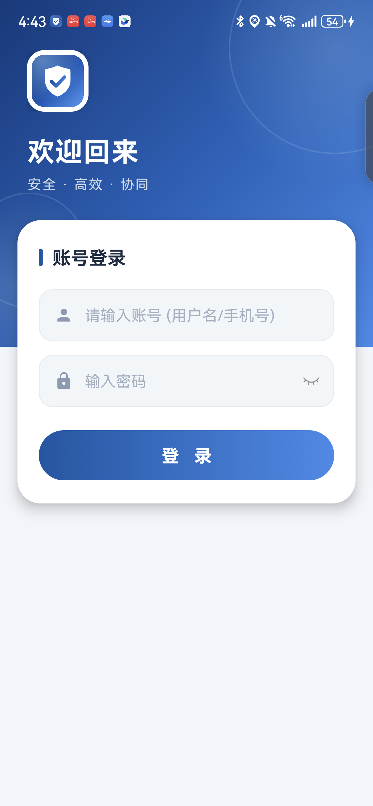
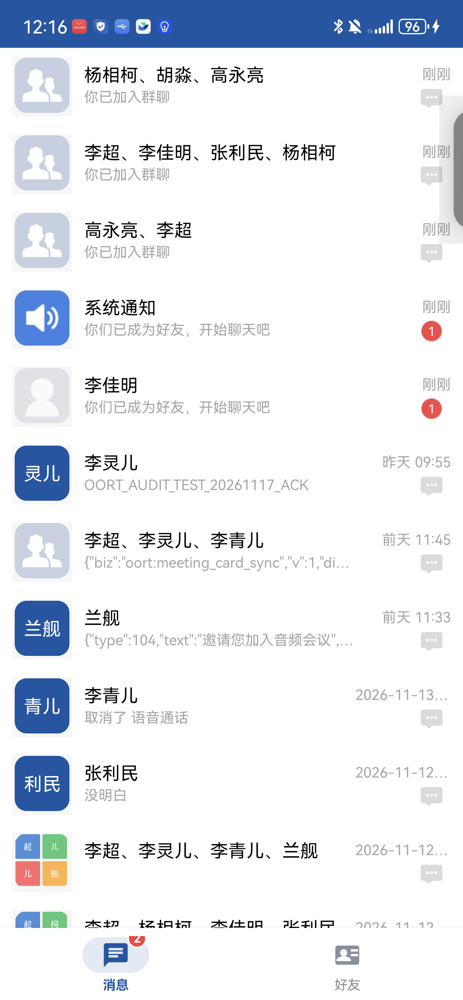
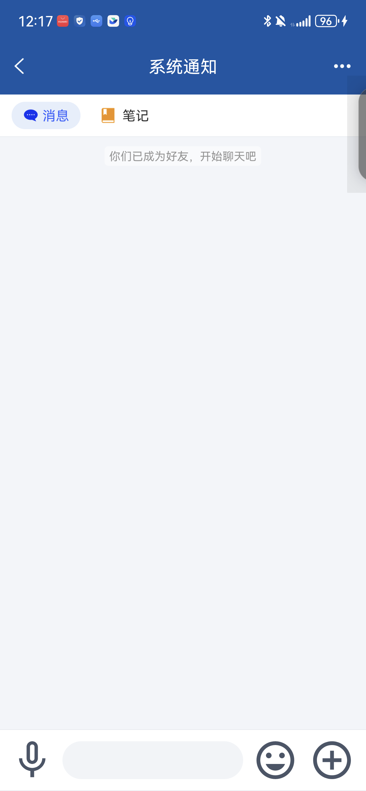
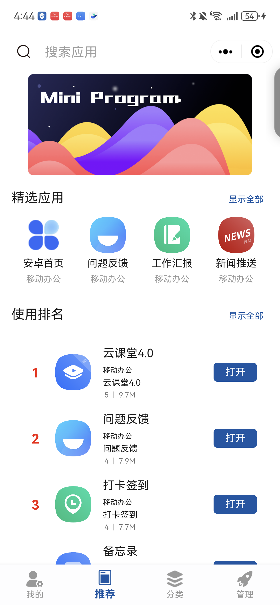
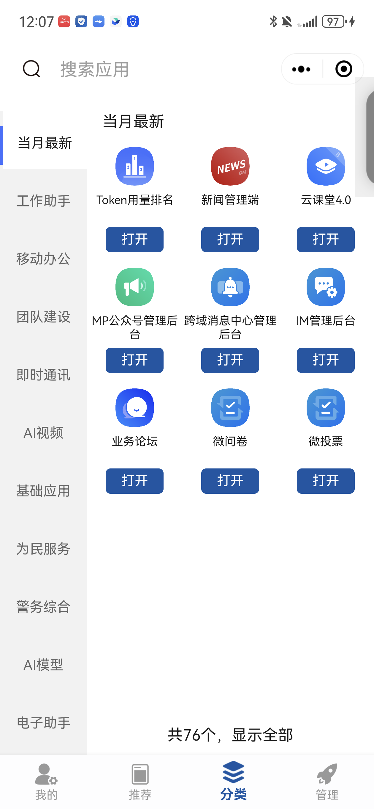

# Demo APK 预览

对应官网下载页「IM-MPAAS-APPSTORE」卡片。可直接安装体验（开发签名，仅供安装验收；与正式包签名不同，混装需先卸载）。

## APK 文件

- `workup-im-sdk-demo.apk`
- `workup-appstore-sdk-demo.apk`

## 界面预览（实机截图，含登录态验收实拍）

<table><tr><td> IM 账号登录页</td><td> IM 会话列表</td><td> 聊天窗口</td><td> 应用市场首页</td><td> 应用分类</td></tr></table>

> 会话、会议等在线功能需登录服务器账号后体验。
> 集成方式见上级目录的 `IM-MPAAS-APPSTORE-SDK集成指南.md`。
