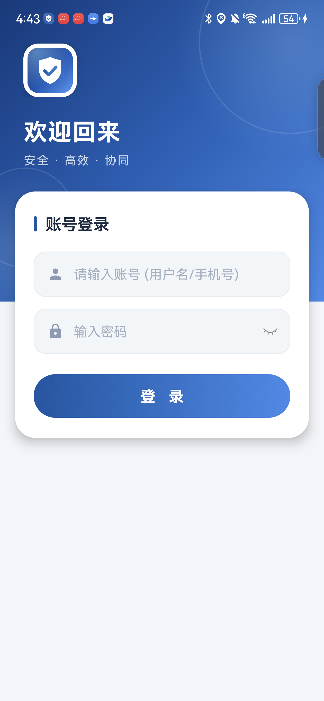
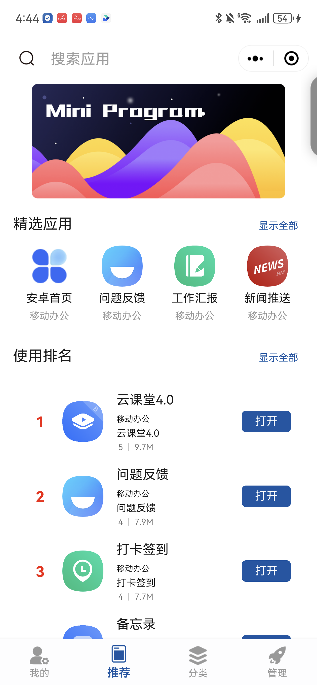

# IM + 应用市场 组合 SDK（2.0.0-rc.20261117.3）

> RC 集成候选，非正式发布版。

## 目录内容

| 文件 | 说明 |
|---|---|
| `IM-MPAAS-APPSTORE-SDK-maven-repo.zip` | **开箱即用依赖包**：解压后得到 `maven-repo/`（file-based Maven 仓库），含本组合全部模块 AAR + POM 及全部内部依赖闭包，离线可用 |
| ``im-2.0.0-rc.20261117.3.aar`、`im-call-2.0.0-rc.20261117.3.aar`、`appstore-2.0.0-rc.20261117.3.aar`` | 本组合直接产出的 AAR（仅供查看/单独取用；单独引入不完整，请用上面的 zip） |

## 快速集成

1. 下载并解压 `IM-MPAAS-APPSTORE-SDK-maven-repo.zip`
2. Gradle 指向解压出的仓库：

```groovy
repositories {
    maven { url = uri('/解压路径/maven-repo') }
    google()
    mavenCentral()
}
dependencies {
    implementation "com.oort.workup:im:2.0.0-rc.20261117.3"
    implementation "com.oort.workup:im-call:2.0.0-rc.20261117.3"
    implementation "com.oort.workup:appstore:2.0.0-rc.20261117.3"
}
```

3. 按需要补充第三方依赖（POM 会自动解析多数项；WebRTC 等见集成指南）。

## 依赖坐标

| 模块 | Maven 坐标 |
|---|---|
| `im` | `com.oort.workup:im:2.0.0-rc.20261117.3` |
| `im-call` | `com.oort.workup:im-call:2.0.0-rc.20261117.3` |
| `appstore` | `com.oort.workup:appstore:2.0.0-rc.20261117.3` |

完整说明见上级目录的 `IM-MPAAS-APPSTORE-SDK集成指南.md`，变更记录见 `IM-MPAAS-APPSTORE-SDK更新日志.md`；仓库根目录的 `maven-repo/` 是全量制品库（含全部 6 种组合）。


## 界面预览

> 以下为 Demo 实机运行截图，无需运行即可预览效果。



*IM 登录页*



*应用市场 Demo 首页*
