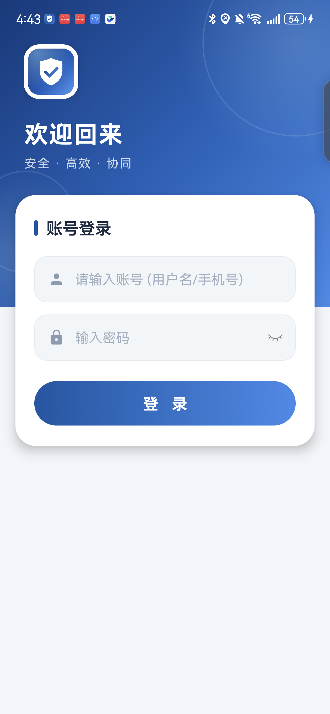
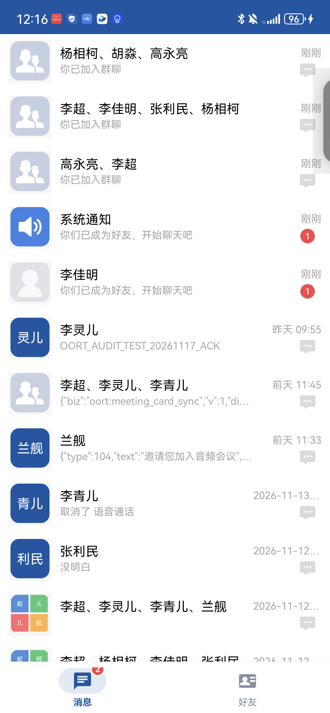
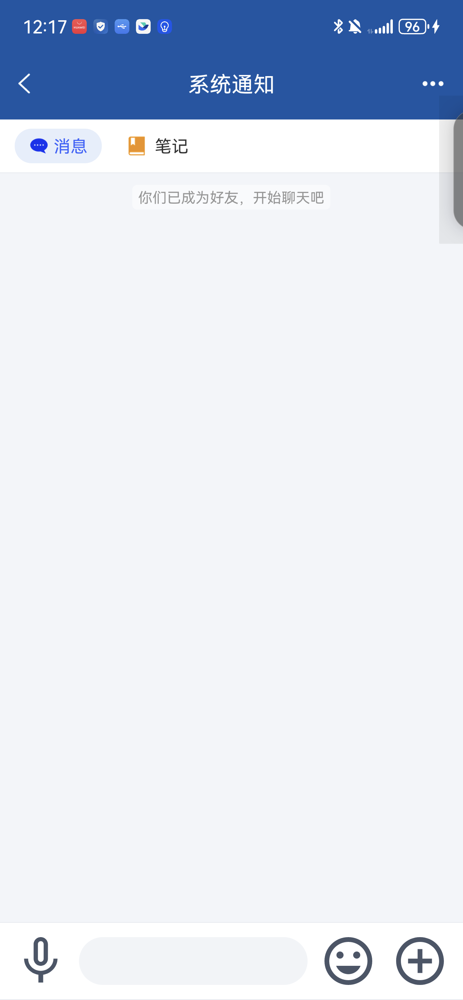
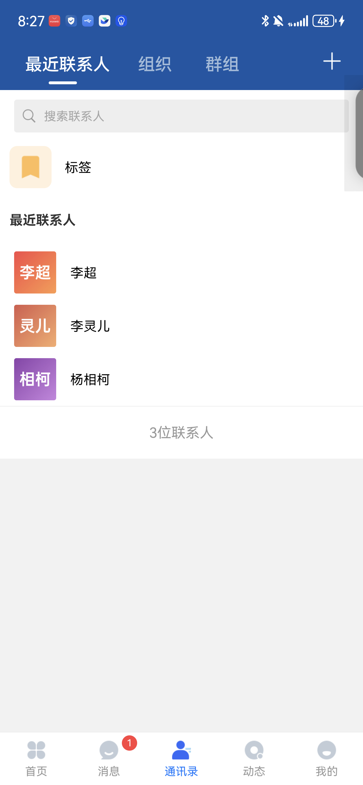
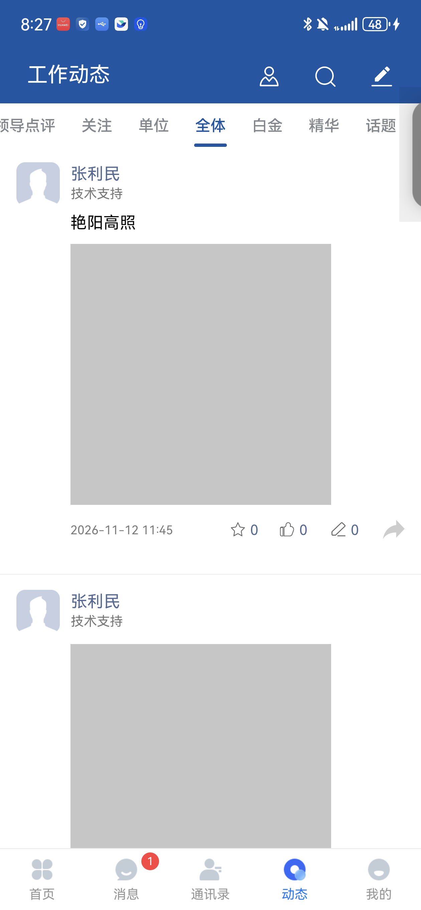
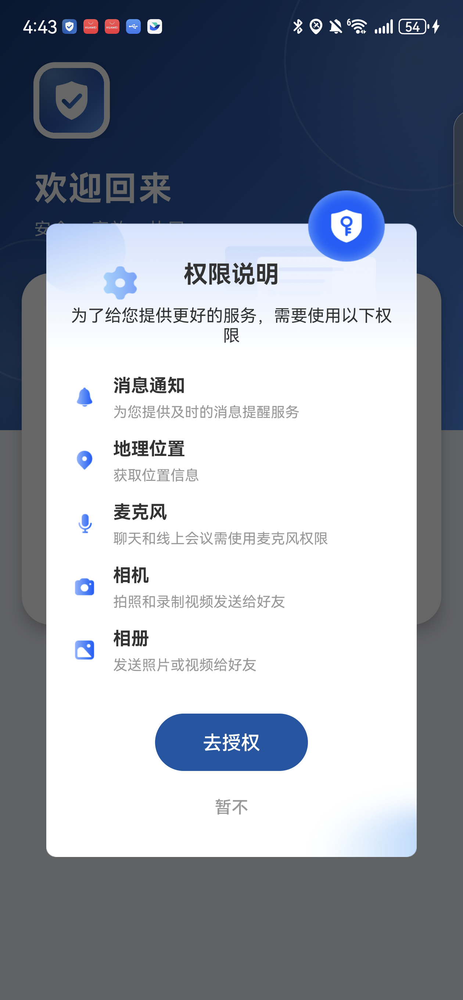
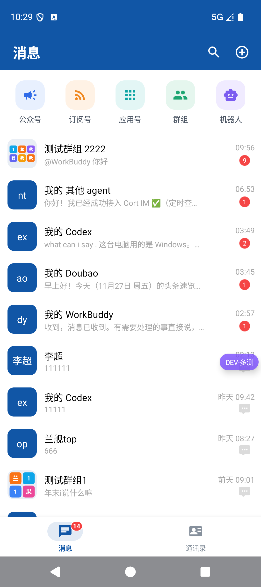
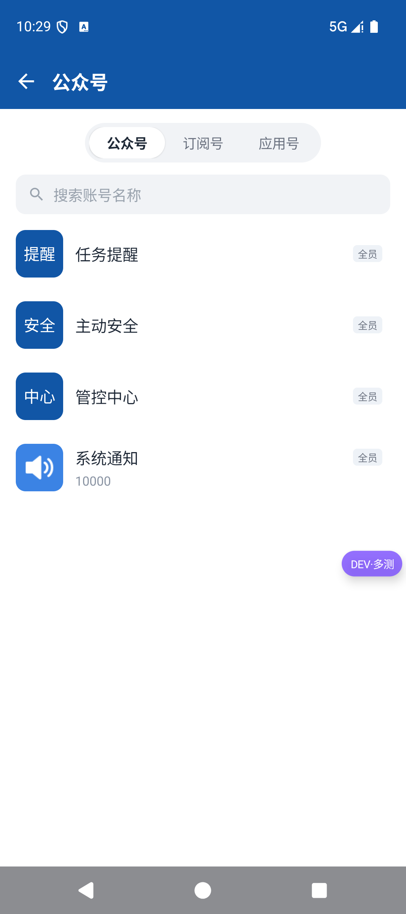
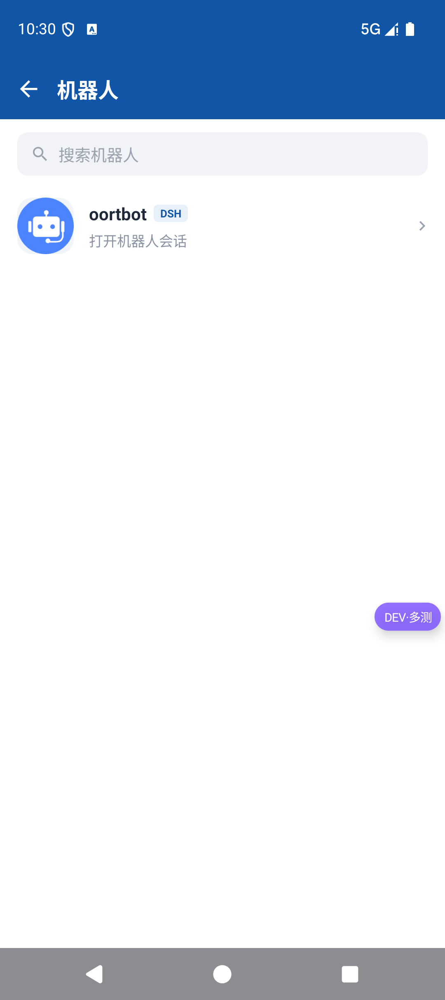
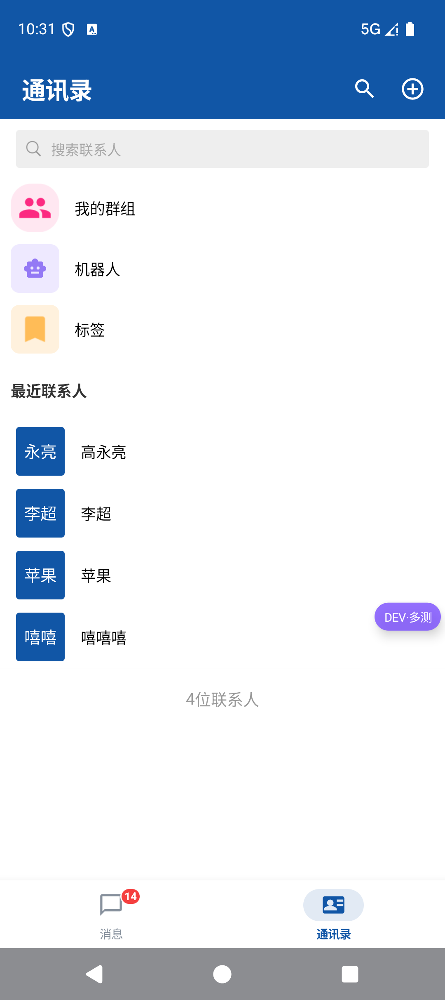

# IM SDK（2.0.0-rc.20261117.3）

> 对应官网下载页「IM」卡片。RC 集成候选，非正式发布版。

## 目录内容

| 内容 | 位置 |
|---|---|
| SDK 依赖包（开箱即用，含完整依赖闭包） | [`IM-SDK/IM-SDK-maven-repo.zip`](IM-SDK) |
| 模块 AAR 与 Maven 坐标说明 | [`IM-SDK/README.md`](IM-SDK/README.md) |
| 编译好的 Demo APK（开发签名，仅验收用） | [`IM-SDK-Demo/`](IM-SDK-Demo) —— `workup-im-sdk-demo.apk` |
| 集成指南 | [`IM-SDK集成指南.md`](IM-SDK集成指南.md) |
| 更新日志 | [`IM-SDK更新日志.md`](IM-SDK更新日志.md) |

## 界面预览（Demo 实机截图，含登录态验收实拍）

<table><tr><td> 账号登录页</td><td> 会话列表</td><td> 聊天窗口</td><td> 通讯录</td><td> 工作动态</td><td> 权限说明</td></tr></table>

### 2026-11-27 开发版新功能预览

> GitLab master 上的新功能实机截图（IM Demo），尚未纳入当前交付包与 Demo APK；变更明细见 [`IM-SDK更新日志.md`](IM-SDK更新日志.md)「开发中」一节。

<table><tr><td> 消息页快捷入口（公众号/订阅号/应用号/群组/机器人）</td><td> 公众号目录（三段切换/搜索）</td><td> 机器人目录</td><td> 机器人会话（设备选择底栏）</td><td> 通讯录「机器人」入口</td></tr></table>

> 会话、会议等在线功能需登录服务器账号后体验。
> 快速集成三步：下载并解压 zip → Gradle 指向其中 `maven-repo/` → 按坐标引入，详见上方集成指南。
