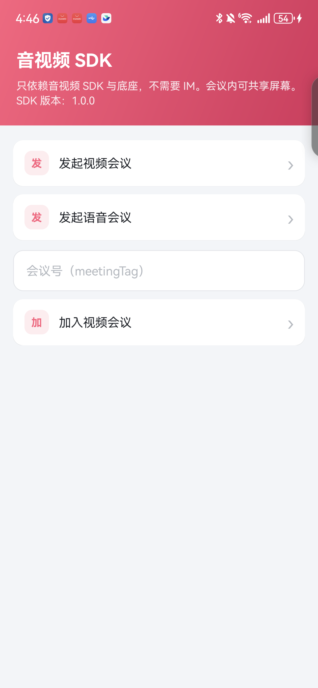

# 音视频 SDK（2.0.0-rc.20261117.3）

> RC 集成候选，非正式发布版。

## 目录内容

| 文件 | 说明 |
|---|---|
| `MEET-SDK-maven-repo.zip` | **开箱即用依赖包**：解压后得到 `maven-repo/`（file-based Maven 仓库），含本组合全部模块 AAR + POM 及全部内部依赖闭包，离线可用 |
| ``av-call-2.0.0-rc.20261117.3.aar`、`av-screen-share-2.0.0-rc.20261117.3.aar`` | 本组合直接产出的 AAR（仅供查看/单独取用；单独引入不完整，请用上面的 zip） |

## 快速集成

1. 下载并解压 `MEET-SDK-maven-repo.zip`
2. Gradle 指向解压出的仓库：

```groovy
repositories {
    maven { url = uri('/解压路径/maven-repo') }   // 本包：com.oort 全部模块+内部依赖闭包
    google()
    mavenCentral()
    maven { url 'https://jitpack.io' }           // swipeback/Luban/MPAndroidChart 等第三方
    maven { url 'https://maven.aliyun.com/repository/jcenter' }  // jcenter 归档库
    maven { url 'https://developer.huawei.com/repo/' }           // 华为 HMS 推送
    maven { url "https://github.com/jitsi/jitsi-maven-repository/raw/master/releases" }
}
dependencies {
    implementation "com.oort.workup:av-call:2.0.0-rc.20261117.3"
    implementation "com.oort.workup:av-screen-share:2.0.0-rc.20261117.3"
}
```

3. 按需要补充第三方依赖（POM 会自动解析多数项；WebRTC 等见集成指南）。

## 依赖坐标

| 模块 | Maven 坐标 |
|---|---|
| `av-call` | `com.oort.workup:av-call:2.0.0-rc.20261117.3` |
| `av-screen-share` | `com.oort.workup:av-screen-share:2.0.0-rc.20261117.3` |

## 音视频额外要求

`av-call` / `av-screen-share` 对 WebRTC 为 `compileOnly`，宿主必须引入：

```groovy
implementation "io.github.webrtc-sdk:android:125.6422.07"
```

完整说明见上级目录的 `MEET-SDK集成指南.md`，变更记录见 `MEET-SDK更新日志.md`；仓库根目录的 `maven-repo/` 是全量制品库（含全部 6 种组合）。


## 界面预览

> 以下为 Demo 实机运行截图，无需运行即可预览效果。



*Demo 首页：发起视频/语音会议、按会议号加入会议*
