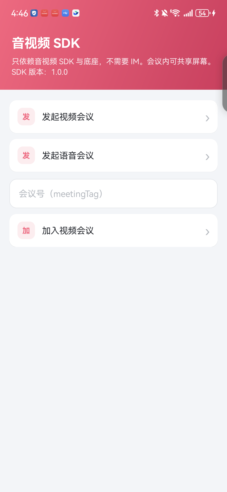
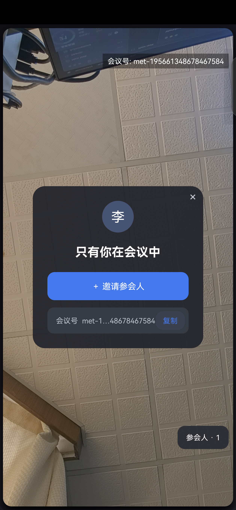
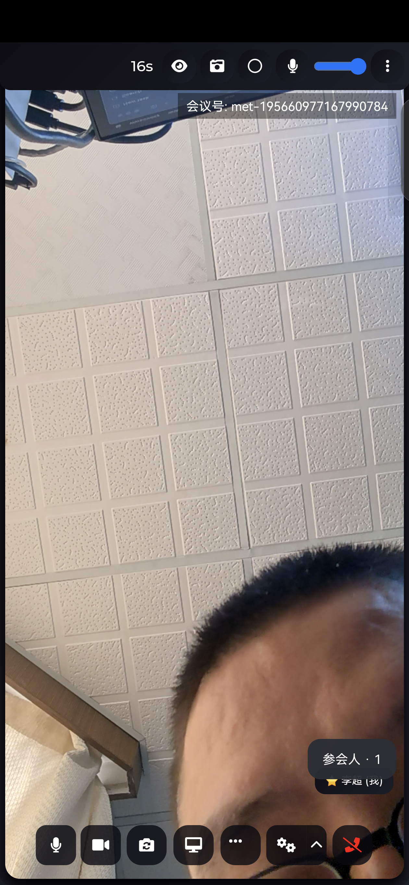

# 音视频 SDK（2.0.0-rc.20261117.3）

> 对应官网下载页「MEET」卡片。RC 集成候选，非正式发布版。

## 目录内容

| 内容 | 位置 |
|---|---|
| SDK 依赖包（开箱即用，含完整依赖闭包） | [`MEET-SDK/MEET-SDK-maven-repo.zip`](MEET-SDK/) |
| 模块 AAR 与 Maven 坐标说明 | [`MEET-SDK/README.md`](MEET-SDK/README.md) |
| 编译好的 Demo APK（开发签名，仅验收用） | [`MEET-SDK-Demo/`](MEET-SDK-Demo/) —— `workup-av-sdk-demo.apk` |
| 集成指南 | [`MEET-SDK集成指南.md`](MEET-SDK集成指南.md) |
| 更新日志 | [`MEET-SDK更新日志.md`](MEET-SDK更新日志.md) |

## 界面预览（Demo 实机截图，含登录态验收实拍）

<table><tr><td> 会议功能菜单</td><td> 会议房间·邀请参会人</td><td> 会议中·视频画面</td></tr></table>

> 会话、会议等在线功能需登录服务器账号后体验。
> 快速集成三步：下载并解压 zip → Gradle 指向其中 `maven-repo/` → 按坐标引入，详见上方集成指南。
