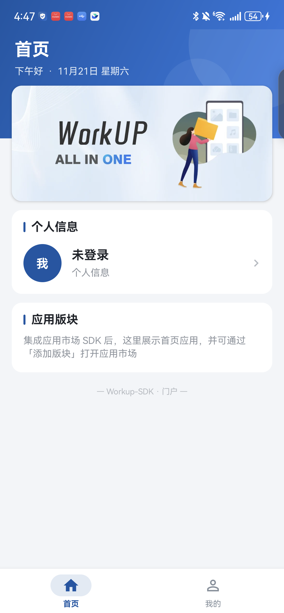
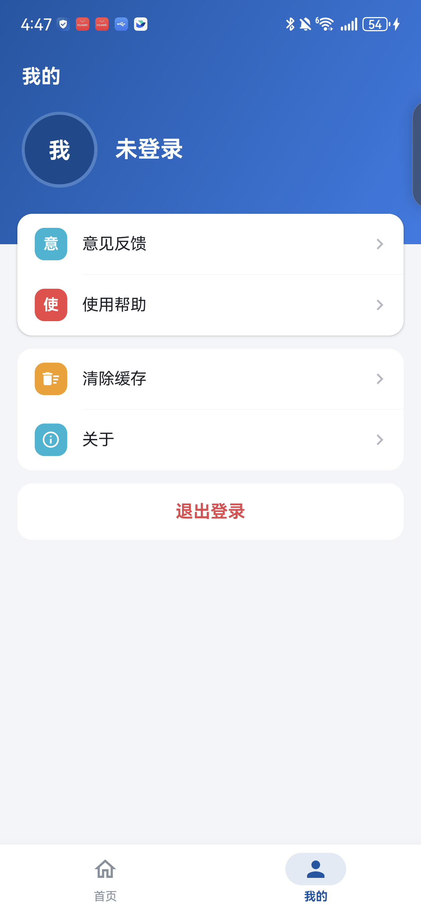
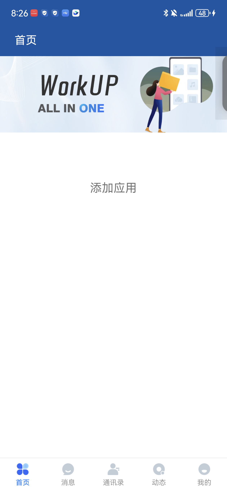

# Demo APK 预览

对应官网下载页「Portal-IM-MPAAS-APPSTORE-MEET」卡片。可直接安装体验（开发签名，仅供安装验收；与正式包签名不同，混装需先卸载）。

## APK 文件

- `workup-portal-sdk-demo.apk`
- `workup-im-sdk-demo.apk`
- `workup-appstore-sdk-demo.apk`
- `workup-av-sdk-demo.apk`

## 界面预览（实机截图，含登录态验收实拍）

<table><tr><td> 门户首页</td><td> 我的</td><td> OA 宿主集成效果</td></tr></table>

> 集成方式见上级目录的 `Portal-IM-MPAAS-APPSTORE-MEET-SDK集成指南.md`。

## 体验账号

安装后可直接登录，体验 IM 消息、通讯录、会议等在线功能（已于 2026-11-23 实机验证：登录、消息收发、通讯录均正常）：

| 项目 | 值 |
|---|---|
| 账号 | 18948726601 |
| 密码 | 12345678 |

> 该账号为公开体验账号，仅用于集成效果验收，请勿用于生产环境；如遇登录失败，可先确认网络可访问 `oa.oortcloudsmart.com`，或联系我们确认服务状态。
