# WorkUp-SDK

> **版本**: `2.0.0-rc.20261117.3`（RC 集成候选，2026-11-17 构建）
> **更新**: 2026-11-21 重构为官网 6 卡片结构，每卡片提供开箱即用依赖包
> **状态**: 可用于集成与验收；正式发布阻塞项（16KB 兼容、RTMP 串流、离线推送等）见交付文档

官网下载页 6 张卡片与仓库目录的对应关系（点目录名或预览即可跳转）：

| 官网下载页卡片 | GitHub 目录 | 预览截图 | 下载内容 |
|---|---|---|---|
| IM | [`IM/`](IM/README.md) | [登录页 + 权限说明（2张）](IM/README.md) | `IM-SDK/IM-SDK-maven-repo.zip`（72.7MB）+ demo APK |
| 应用市场 | [`MPAAS-APPSTORE/`](MPAAS-APPSTORE/README.md) | [市场首页/应用详情/工作台/菜单（4张）](MPAAS-APPSTORE/README.md) | `…-SDK/…-maven-repo.zip`（5.3MB）+ demo APK |
| IM+应用市场 | [`IM-MPAAS-APPSTORE/`](IM-MPAAS-APPSTORE/README.md) | [IM 登录 + 应用市场首页](IM-MPAAS-APPSTORE/README.md) | 组合依赖包 zip（75.7MB）+ demo APK |
| 音视频 | [`MEET/`](MEET/README.md) | [会议菜单 + OA宿主效果（2张）](MEET/README.md) | `MEET-SDK/MEET-SDK-maven-repo.zip`（0.2MB）+ demo APK |
| IM+应用市场+音视频 | [`IM-MPAAS-APPSTORE-MEET/`](IM-MPAAS-APPSTORE-MEET/README.md) | [三类截图合集](IM-MPAAS-APPSTORE-MEET/README.md) | 组合依赖包 zip（75.7MB）+ demo APK |
| 首页+IM+应用市场+音视频 | [`Portal-IM-MPAAS-APPSTORE-MEET/`](Portal-IM-MPAAS-APPSTORE-MEET/README.md) | [门户首页 + 我的 + OA宿主](Portal-IM-MPAAS-APPSTORE-MEET/README.md) | Portal 依赖包 zip（75.8MB）+ demo APK |

每个卡片目录结构统一：

```
<卡片>/
├── <卡片>-SDK/                  # <卡片>-SDK-maven-repo.zip（依赖闭包）+ 直接 AAR + README
├── <卡片>-SDK-Demo/             # 编译好的 demo APK（开发签名，仅验收用）
├── <卡片>-SDK集成指南.md
└── <卡片>-SDK更新日志.md
```

## 快速集成（三步）

1. 下载卡片目录里的 `<卡片>-SDK-maven-repo.zip` 并解压
2. Gradle 指向解压出的仓库：

```groovy
repositories {
    maven { url = uri('/解压路径/maven-repo') }   // 本包：com.oort 全部模块+内部依赖闭包
    google()
    mavenCentral()
    maven { url 'https://jitpack.io' }           // swipeback/Luban/MPAndroidChart 等第三方
    maven { url 'https://maven.aliyun.com/repository/jcenter' }  // jcenter 归档库
    maven { url 'https://developer.huawei.com/repo/' }           // 华为 HMS 推送
    maven { url "https://github.com/jitsi/jitsi-maven-repository/raw/master/releases" }
}
dependencies {
    // 按卡片引入坐标，例如 IM：
    implementation "com.oort.workup:im:2.0.0-rc.20261117.3"
}
```

3. 各卡片的坐标清单见 `<卡片>-SDK/README.md`；音视频相关卡片需宿主额外引入 `io.github.webrtc-sdk:android:125.6422.07`。

## 说明

- 每个 `-maven-repo.zip` 内含该组合的 **com.oort 全部模块 AAR+POM 及内部依赖闭包**，解压即用；第三方公开依赖（AndroidX、Smack、JitPack 系等）由 POM 声明、需联网从公共仓库解析——**repositories 必须按「快速集成」的完整清单配置**（缺 jitpack/aliyun-jcenter/华为仓库会解析失败），已实测 289 个制品全部可解析。
- [`maven-repo/`](maven-repo) 是全量 file-based 制品库（覆盖全部 6 种组合的所有模块），整仓 clone 的用户可直接指向它。
- demo APK 为开发签名，仅供安装验收，不能覆盖签名不同的正式包。
- 完整组合宿主 APK（OA2443，199MB）超过 GitHub 单文件 100MB 限制，未随仓库分发。
- RC 集成候选 ≠ 正式发布版。

## 界面预览（无需运行，全部为 Demo 实机截图，含登录态验收实拍）

**IM SDK**

<table>
<tr>
<td>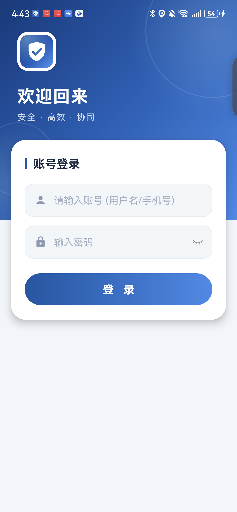<br/><sub>账号登录页</sub></td>
<td>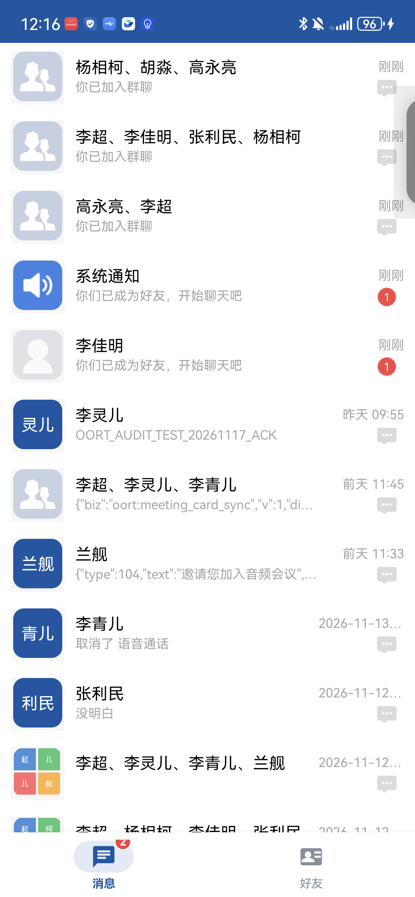<br/><sub>会话列表（群聊/好友/未读）</sub></td>
<td>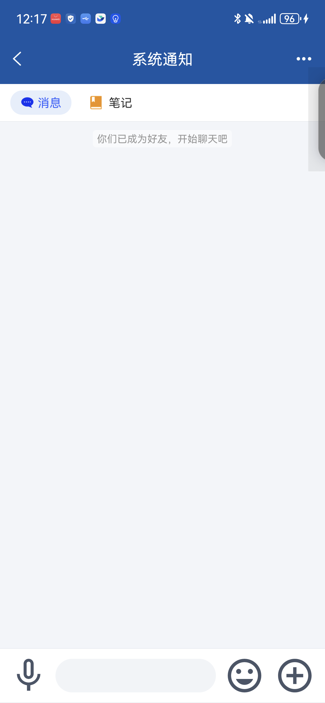<br/><sub>聊天窗口</sub></td>
</tr>
<tr>
<td>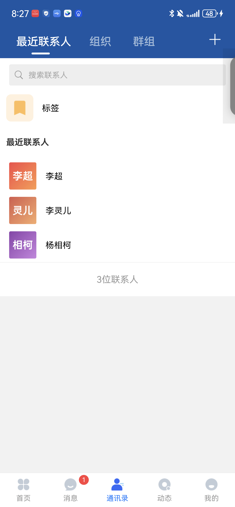<br/><sub>通讯录（最近/组织/群组）</sub></td>
<td>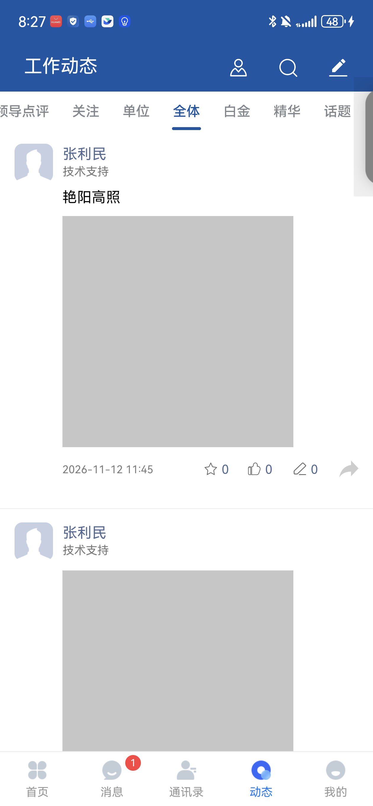<br/><sub>工作动态</sub></td>
<td>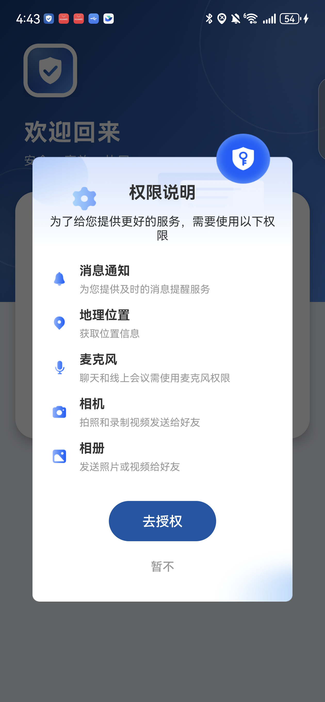<br/><sub>权限说明</sub></td>
</tr>
</table>

**应用市场 SDK**

<table><tr>
<td>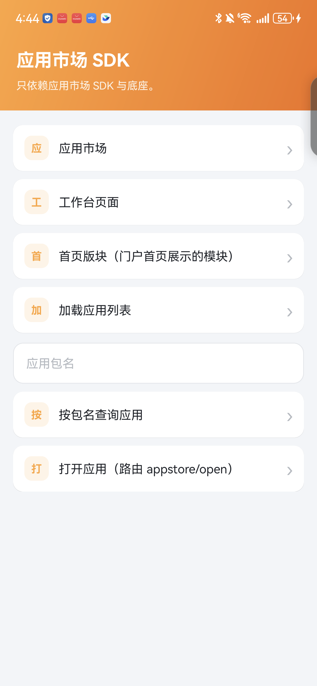<br/><sub>Demo 功能菜单</sub></td>
<td>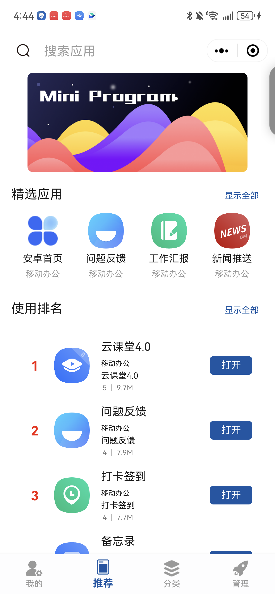<br/><sub>应用市场首页</sub></td>
<td>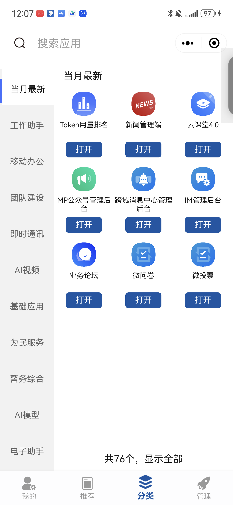<br/><sub>分类（76 个应用）</sub></td>
<td>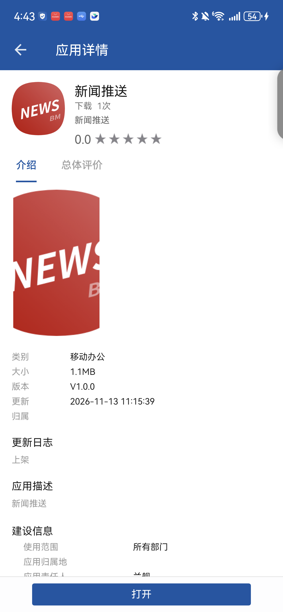<br/><sub>应用详情</sub></td>
</tr></table>

**音视频 SDK**

<table><tr>
<td>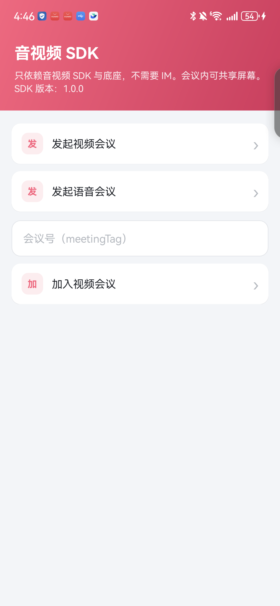<br/><sub>发起/加入会议菜单</sub></td>
<td>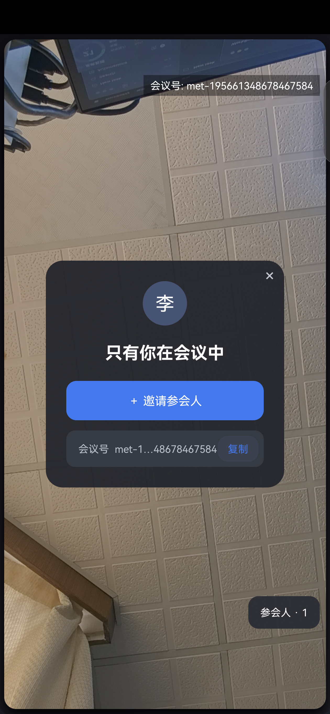<br/><sub>会议房间（邀请参会人）</sub></td>
<td>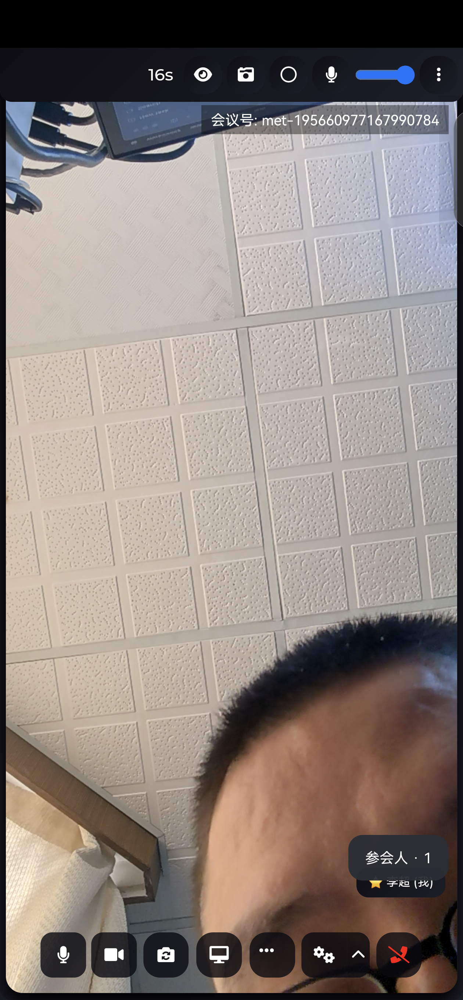<br/><sub>会议中（视频+控制栏）</sub></td>
</tr></table>

**首页（门户）SDK**

<table><tr>
<td>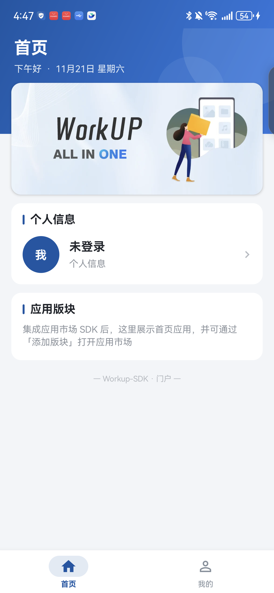<br/><sub>门户首页</sub></td>
<td>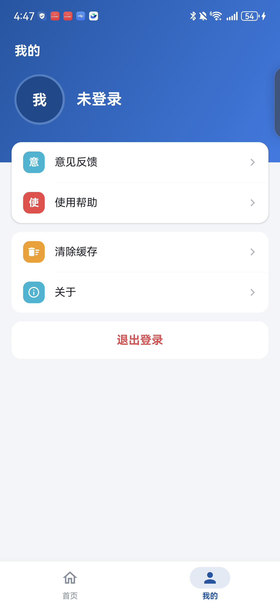<br/><sub>我的</sub></td>
<td>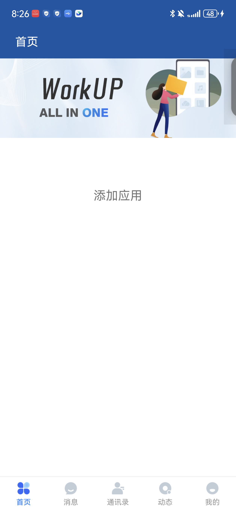<br/><sub>OA 宿主集成效果</sub></td>
</tr></table>

> 登录态截图（会话列表、聊天、会议等）来自验收测试时实拍；会议、聊天等在线功能可使用下方体验账号登录后体验。

## 体验账号

安装任意 Demo APK 后可直接登录，体验 IM 消息、通讯录、会议等在线功能（已于 2026-11-23 实机验证：登录、消息收发、通讯录均正常）：

| 项目 | 值 |
|---|---|
| 账号 | 18948726601 |
| 密码 | 12345678 |

> 该账号为公开体验账号，仅用于集成效果验收，请勿用于生产环境；如遇登录失败，可先确认网络可访问 `oa.oortcloudsmart.com`，或联系我们确认服务状态。
